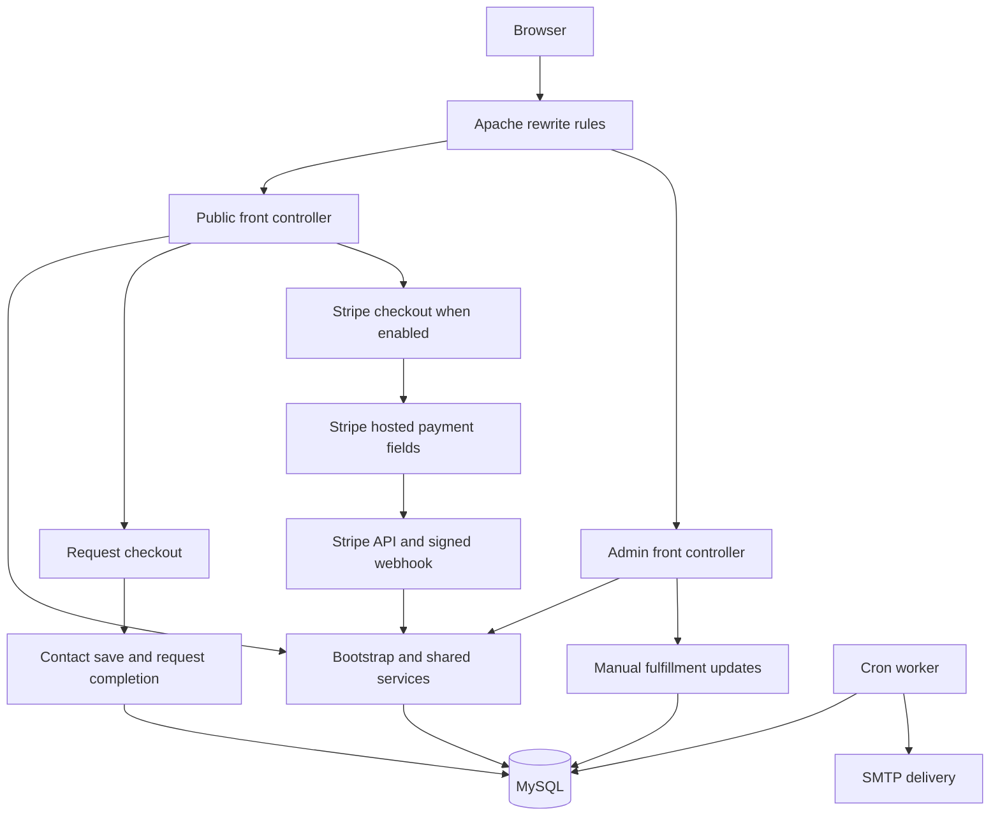

# MI Tech Wireless developer guide

This is the engineering handover for the PHP and MySQL application in [mancode-lk/mitechwireless](https://github.com/mancode-lk/mitechwireless). It explains how to install, change, test, deploy and operate the storefront, and where to connect real payments. The application baseline is commit `b5f4258b6fa9a5d5c3111922922b39dc6eb5b176`, reviewed on **October 16, 2026**. Runtime settings and database records can change independently of Git.

The current request checkout saves customer contact details and the selected top-up, displays a browser-only card form, and finishes on a thank-you page. **That flow does not charge a card or fulfill a recharge.** A separate Stripe PaymentIntent implementation exists in the repository. Its activation requirements and remaining integration issues are described below.

## Contents

- [Product and operating model](#product-and-operating-model)
- [Architecture and source map](#architecture-and-source-map)
- [Local installation](#local-installation)
- [Configuration and settings](#configuration-and-settings)
- [Public routes](#public-routes)
- [Request checkout](#request-checkout)
- [Stripe checkout](#stripe-checkout)
- [HTTP API reference](#http-api-reference)
- [Database and record lifecycle](#database-and-record-lifecycle)
- [Carrier catalog](#carrier-catalog)
- [Admin console](#admin-console)
- [Email delivery](#email-delivery)
- [Frontend and asset workflow](#frontend-and-asset-workflow)
- [Validation and security](#validation-and-security)
- [Testing](#testing)
- [Deployment and rollback](#deployment-and-rollback)
- [Payment integration handover](#payment-integration-handover)
- [Troubleshooting](#troubleshooting)
- [Known limitations and maintenance](#known-limitations-and-maintenance)
- [Common change locations](#common-change-locations)
- [Reference documents](#reference-documents)

## Product and operating model

| Item | Implemented behavior |
| --- | --- |
| Public website | <https://mitechwireless.com> |
| Administration | `/admin`, with login at `/admin/login` |
| Support | `info@mitechwireless.com`; optional phone, hours and address are configurable |
| Market | Existing eligible US prepaid numbers; amounts in USD |
| Purchase model | Guest checkout, one selected top-up per checkout, one-time transactions |
| Fulfillment | A staff member manually fulfills a paid order outside this application |
| Current checkout | Contact details → browser-only card UI → submitted unpaid request |
| Actual payment implementation | Stripe Payment Element and PaymentIntents, behind separate settings |
| Order tracking | Random reference plus the checkout email |
| Customer accounts | No customer registration, login or account portal |
| Carrier automation | No carrier API, SIM activation, porting or automated recharge integration |

The six selected carriers and catalog counts are:

| Carrier | Slug | Displayed options | Selectable for unpaid requests | Carrier links only |
| --- | --- | ---: | ---: | ---: |
| Simple Mobile | `simple-mobile` | 6 | 5 | 1 |
| T-Mobile | `t-mobile` | 10 | 8 | 2 |
| Lyca Mobile | `lyca-mobile` | 12 | 10 | 2 |
| Ultra Mobile | `ultra-mobile` | 13 | 10 | 3 |
| H2O Wireless | `h2o-wireless` | 11 | 11 | 0 |
| AT&T | `att` | 11 | 5 | 6 |
| Total | | 63 | 49 | 14 |

These counts describe the committed catalog snapshot checked on October 15, 2026. They do not establish current distributor availability. Some ordinary monthly options, as well as promotions, are carrier links only. The [catalog reference](docs/CATALOG_REFERENCE.md) lists every option, allowance, condition, amount and source link.

## Architecture and source map

The application is server-rendered PHP with small browser JavaScript files. There is no framework router, ORM, frontend SPA, Node production server or build-time secret injection.



| File or directory | Responsibility |
| --- | --- |
| [index.php](index.php) | Root entry point; loads the public controller |
| [.htaccess](.htaccess) | HTTPS redirect, route rewriting, private-path blocking and cache/security headers |
| [public/index.php](public/index.php) | Public route dispatch and API entry points |
| [public/home.php](public/home.php), [public/carriers.php](public/carriers.php), [public/plans.php](public/plans.php) | Homepage, directory and carrier options |
| [public/checkout.php](public/checkout.php) | Chooses request checkout or Stripe checkout |
| [public/request-checkout.php](public/request-checkout.php) | Contact form and temporary card UI |
| [public/thank-you.php](public/thank-you.php), [public/request-thank-you.php](public/request-thank-you.php) | Payment/order and request confirmation pages |
| [public/track.php](public/track.php), [public/pages.php](public/pages.php), [public/404.php](public/404.php) | Tracking, informational/policy pages and missing-page output |
| [includes/bootstrap.php](includes/bootstrap.php) | Configuration, Composer loader, sessions, error handling, headers and shared services |
| [includes/functions.php](includes/functions.php) | PDO helpers, validation, encryption, settings, authorization, rate limiting and catalog metadata |
| [includes/requests.php](includes/requests.php) | Contact/request persistence, selection validation and request access |
| [includes/payments.php](includes/payments.php) | PaymentIntent creation, payment reconciliation, webhooks and mail enqueueing |
| [includes/mail.php](includes/mail.php) | PHPMailer setup, message templates and queue processing |
| [includes/layout.php](includes/layout.php) | Shared public layout, navigation, footer, FAQ and order display |
| [admin/index.php](admin/index.php) | Admin login, authorization, route dispatch and action execution |
| [admin/actions.php](admin/actions.php) | Catalog edits, settings, password changes, fulfillment, refunds and mail actions |
| [admin/views.php](admin/views.php), [admin/requests.php](admin/requests.php), [admin/login.php](admin/login.php) | Admin screens and request listings |
| [assets/](assets/) | Source and compiled CSS/JS, brand artwork and carrier logos |
| [config/example.php](config/example.php) | Private configuration template; no production secrets |
| [sql/](sql/) | Base schema, request table and selected-catalog migration |
| [research/](research/) | Current metadata, generation inputs, historical research and artwork provenance |
| [tools/](tools/) | CLI installation, migrations, local router, mail worker and asset/catalog builders |
| [tests/](tests/) | Script-based Playwright browser checks |
| [vendor/](vendor/) | Committed, locked PHP dependencies for direct hosting deployment |
| [storage/](storage/) | Reserved directory; not the configured PHP session save path |

Every dynamic request loads configuration and Composer, sets PHP's default timezone to UTC, and loads the common functions, payments and mail services. Non-CLI requests also start `MITECH_SESSION` and emit security headers. SQL is executed through prepared PDO statements. Templates escape dynamic values through `e()`.

## Local installation

### Runtime requirements

- PHP **8.1 or newer** is declared in `composer.json`; Composer resolves against platform `8.2.34`. Run `composer check-platform-reqs` against the actual deployment runtime.
- PHP extensions: PDO MySQL, mbstring, OpenSSL, cURL, GD and fileinfo. A working PHP session directory is also required.
- MySQL-compatible InnoDB, with the new database created using `utf8mb4`; the deployment supports a compatible MariaDB installation.
- Apache with rewrite support for production. The bundled PHP router is for loopback development only.
- Node and pnpm for rebuilding frontend assets or running browser checks. Python 3 is needed only for catalog generation. None is required to serve the compiled site.

Locked PHP package versions:

| Package | Locked version | Purpose |
| --- | --- | --- |
| `giggsey/libphonenumber-for-php` | `9.0.41` | US number parsing and regional validation |
| `giggsey/locale` | `2.9.0` | Phone-library dependency |
| `phpmailer/phpmailer` | `7.1.1` | SMTP |
| `stripe/stripe-php` | `19.4.1` | Stripe API and webhook signatures |
| `symfony/polyfill-mbstring` | `1.43.0` | Dependency compatibility |

`composer.lock` and `pnpm-lock.yaml` are authoritative for reproducible dependency installation. Do not run dependency updates as an incidental deployment step.

### Fresh installation procedure

1. Clone the repository and create a **new, empty QA database** with a dedicated database user. Never use the production database for setup or browser testing.

   ```powershell
   git clone https://github.com/mancode-lk/mitechwireless.git
   Set-Location .\mitechwireless
   ```
2. Copy `config/example.php` to a private location outside the checkout. Populate the DSN and credentials. Use `environment => 'development'`, `base_url => 'http://127.0.0.1:8096'` and the required reporting timezone for local HTTP.
3. Generate the application encryption key once and paste it into the private configuration:

   ```sh
   php -r "echo bin2hex(random_bytes(32)), PHP_EOL;"
   ```

4. Ensure the private directory exists and is writable by the installer. Choose a private output file for the initial admin credentials. The installer reads this path **after** schema creation; a missing output variable can leave an installed database without the credential file. Set and verify it before starting. The script expects an outside-webroot path but does not itself enforce that location.
5. Install dependencies if needed and check the runtime:

   ```sh
   composer install --no-dev --prefer-dist --optimize-autoloader
   composer check-platform-reqs
   ```

6. Run the installer once. The following PowerShell example assumes a private QA configuration already exists:

   ```powershell
   $env:MITECH_CONFIG = 'C:\private\mitechwireless-qa\config.php'
   $env:MITECH_CREDENTIAL_OUTPUT = 'C:\private\mitechwireless-qa\admin-access.md'
   php tools/install.php
   ```

   Linux equivalent, from the checkout:

   ```sh
   MITECH_CONFIG=/srv/private/mitechwireless-qa/config.php \
   MITECH_CREDENTIAL_OUTPUT=/srv/private/mitechwireless-qa/admin-access.md \
   php tools/install.php
   ```

7. Start the preview in that same configured environment:

   ```sh
   php -S 127.0.0.1:8096 -t . tools/router.php
   ```

8. Visit `/admin/login`. The generated account email is `info@mitechwireless.com`; read its unique password from the private output file. Change it on first login. The new password must differ from the old password, match confirmation and be at least 14 bytes long.
9. To reproduce the current request flow, open Settings and enable **Accept recharge requests without online payment**. A fresh installation leaves checkout disabled; the current catalog migration does not enable this setting.

The installer runs `sql/schema.sql`, then `sql/demo.sql`, then `sql/selected-carriers.sql`, before creating the admin account. It refuses any database that already has tables. `schema.sql` includes the older starter catalog; the final migration activates the selected six-carrier catalog. Importing only `schema.sql` is not a complete installation of the current application. Do not rerun the installer or import the seed into an existing site.

### Configuration lookup

`includes/bootstrap.php` first uses `MITECH_CONFIG` when set; otherwise it looks for `mitechwireless-private/config.php` beside the application root. If that selected file is absent, it falls back to `config/local.php`. If neither file exists, startup fails. Configuration is a PHP array, not an automatically loaded `.env` file.

## Configuration and settings

### Private configuration fields

| Key | Meaning |
| --- | --- |
| `dsn` | PDO MySQL connection string, including `charset=utf8mb4` |
| `db_user`, `db_password` | Dedicated database credentials |
| `app_key` | 64 hex characters representing 32 random bytes; used for AES-GCM encryption and rate-limit HMACs |
| `base_url` | Public origin used in emails and configuration output; use the QA origin locally |
| `environment` | Exactly `production` makes the session cookie Secure; use a different value for loopback HTTP |
| `timezone` | Reporting/display timezone, normally `America/New_York` |

Keep the application key with protected backups. Changing it without re-encrypting saved integration settings prevents decryption. It is unrelated to Stripe keys and does not authenticate customers.

### Database settings

All settings are string values in the `settings` table. `settings()` loads them once per PHP request; normal admin writes redirect to make the next request see the new values.

| Keys | Behavior |
| --- | --- |
| `request_checkout_enabled` | `1` selects unpaid request checkout; takes precedence over the legacy toggle |
| `demo_checkout_enabled` | Fallback only when the new setting is absent; the old name remains for compatibility |
| `checkout_enabled` | Enables the separate real-payment checkout when its other prerequisites pass |
| `stripe_mode` | `test` or `live`; unrecognized values fall back to test in `stripe_mode()` |
| `stripe_test_publishable`, `stripe_live_publishable` | Public Stripe keys; stored as plain settings |
| `stripe_test_secret`, `stripe_live_secret` | Secret API keys, encrypted before storage |
| `stripe_test_webhook`, `stripe_live_webhook` | Webhook signing secrets, encrypted before storage |
| `smtp_host`, `smtp_port`, `smtp_security`, `smtp_username` | SMTP host, port, `tls`/`ssl` and username |
| `smtp_password` | SMTP password, encrypted before storage |
| `sender_email`, `support_email` | Message sender and support/reply-to address |
| `site_name`, `site_logo` | Brand name and header logo |
| `color_primary`, `color_secondary`, `color_accent` | Theme colors; primary and secondary must pass the admin's 4.5:1 white-text contrast check |
| `hero_title`, `hero_accent`, `hero_description` | Homepage headline and introduction |
| `support_phone`, `support_hours`, `business_address` | Optional contact-page information |
| `faqs` | JSON list of question/answer objects; up to 40 entries |
| `footer_links` | JSON list of up to 10 `{label,url}` entries using accepted HTTPS or local paths |

Blank secret-key/password inputs preserve saved encrypted values. Publishable keys are ordinary inputs and can be cleared. There is no dedicated UI action for deleting an encrypted secret.

`checkout_ready()` requires request mode off, `checkout_enabled=1`, and nonempty publishable, decrypted secret and decrypted webhook keys for the selected mode. The Settings save action additionally requires SMTP configuration before enabling checkout. This is a configuration-presence check, not a successful connection test.

## Public routes

Routes use root-relative paths. Hosting under a subdirectory requires route, asset, cookie-path and redirect work.

| Method | URL | Handler and purpose |
| --- | --- | --- |
| GET | `/` | Homepage, carrier selector and support content |
| POST | `/start` | Validate CSRF, US phone and active carrier; store phone in session; redirect to carrier |
| GET | `/carriers` | Active carrier directory |
| GET | `/carriers/{slug}` | Active carrier details and plans; unknown/inactive carrier returns 404 |
| GET | `/checkout?plan={id}` | Request checkout or Stripe checkout, depending on settings |
| GET | `/checkout?carrier={id}` | Request mode can select the first eligible plan for a carrier; Stripe mode expects a plan |
| GET | `/thank-you?request={reference}` | Completed request, authorized by current session |
| GET | `/thank-you?order={number}` | Stripe order, authorized by current session; may reconcile pending payment |
| GET, POST | `/track` | Tracking form; POST looks up order/request by reference and email |
| GET | `/faq`, `/about`, `/contact` | Content from templates and settings; contact is a mail link, not a message-submission endpoint |
| GET | `/terms`, `/privacy`, `/refund-policy` | Policy templates in `public/pages.php` |
| POST | `/api/checkout-request/details` | Save permitted contact details |
| POST | `/api/checkout-request/complete` | Mark a request submitted |
| POST | `/api/checkout` | Create/reuse a Stripe order and PaymentIntent |
| POST | `/api/webhook` | Verify and process Stripe events |

Compatibility aliases `/api/demo/details`, `/api/demo/complete` and `/thank-you?demo=...` still work. They use the same authorization and storage logic. Most page routes do not enforce a strict GET-only method check; API handlers do enforce POST. `redirect()` uses HTTP 303.

## Request checkout

### Sequence and data ownership

1. `request_selection()` loads an active plan and active carrier, then checks the JSON metadata's `selectable` flag. Carrier-only options cannot be submitted through this handler.
2. The checkout page creates a random 64-character key in `$_SESSION['request_keys']`, indexed by `carrier_id:plan_id`.
3. The browser submits only the form's permitted contact and selection fields to `/api/checkout-request/details`.
4. The server validates the inputs, uses its database price, and inserts or updates `demo_submissions` inside a transaction. **Contact information is saved at this step**, even if the visitor never completes the card screen.
5. A new reference has the form `MI-RQ-` plus 12 uppercase hexadecimal characters. Legacy `DEMO-` references remain accepted.
6. The browser hides the contact form and displays the card UI. Its values stay in memory in the input elements.
7. Continue validates the UI fields, clears them, and posts only `csrf` and `reference` to `/api/checkout-request/complete`.
8. The server sets `completed_at` once and returns a thank-you URL. It does not create a customer, order, payment, fulfillment job or email job.

The request has two progress states derived from `completed_at`: **Details saved** when NULL, and **Submitted** when populated. Both remain **Awaiting payment**. There is no payment-status column in the request table and no admin action that converts a request into a paid order.

### Saved and unsaved fields

The saved contact fields are `customer_name`, `email` and the phone number. Compatibility columns `customer_phone` and `recharge_phone` both receive that same number; new `zip` values are empty. Selection snapshots, amount, reference, access hash, checkout key and timestamps are also stored. There is no request-table cardholder, card number, expiry, CVC, card brand or last-four field.

The card UI requires name on card, a 13–19-digit number passing Luhn, a current/future `MM / YY` expiry and a 3–4-digit CVC. These are browser checks, not authorization or card-ownership checks. The inputs have no `name` attributes and no form owner. They are cleared before the completion request, when editing contact details, and on `pagehide`/`pageshow`. The request API rejects unexpected POST field names, including card fields. Do not add analytics, session replay or logging that captures these values.

### Access and retries

The server derives a per-request access value from the checkout key and session CSRF token and stores only its SHA-256 hash in the database. The corresponding access value remains in the session; up to 20 request access entries are retained. Knowing the reference alone does not authorize the thank-you page.

Repeated detail submissions reuse the row for the same checkout key. Contact edits apply only before completion. Repeated completion calls preserve the original timestamp. Starting checkout again after a completed request resets the selection's checkout key. Tracking from another browser instead requires the reference **and** email, and only completed requests are returned.

## Stripe checkout

The existing Stripe flow uses `public/checkout.php`, `assets/checkout.js` and `includes/payments.php`. Request mode must be off. Both the selected carrier and plan must be active, and the plan must have `verify_pricing=0`.

This older form asks for name, email, recharge phone, a separate contact phone, billing ZIP and terms acceptance. **Switching modes does not preserve the current three-field contact experience automatically.** Adapting that form and backend validation is a separate integration change.

### Order and payment lifecycle

1. `/api/checkout` validates the session and input, reads the plan price from MySQL and derives an idempotent checkout hash from the session key, submitted details, plan and Stripe mode.
2. It creates/reuses a customer by email. Because email ownership is unverified in guest checkout, an existing customer profile is not overwritten; the order stores the submitted contact snapshot.
3. It creates/reuses an `orders` row with an `MI-` reference, `payment_status=pending` and `recharge_status=awaiting_payment`.
4. It creates/retrieves a Stripe PaymentIntent in USD with card payments and `order_number` metadata. The creation idempotency key is `mitech-{order_number}`; the SDK allows two network retries.
5. The response contains the client secret, order number and publishable key. Stripe.js mounts the Payment Element, then `confirmPayment()` handles payment and any required redirect.
6. A signed webhook or the authorized thank-you page calls `reconcile_payment()`. The service locks the order row, fetches the current PaymentIntent with its latest charge, and checks mode, live flag, amount, currency and order metadata.
7. A confirmed success changes payment to `paid`, advances fulfillment from `awaiting_payment` to `processing`, records `paid_at`, and queues the receipt and admin alert.
8. Staff complete the actual carrier refill separately and mark the order `recharged`, which queues the completion email.

| State family | Values and meaning |
| --- | --- |
| Payment | `pending`, `paid`, `failed`, `partially_refunded`, `refunded` |
| Fulfillment | `awaiting_payment`, `processing`, `recharged`, `failed`, `refunded` |

Payment failure/cancellation does not itself perform a recharge. Admin fulfillment edits accept only `processing`, `recharged` or `failed`, and require `payment_status=paid`. Full refund reconciliation sets fulfillment to `refunded`. Partial refunds retain the previous fulfillment value but prevent further fulfillment editing through the current admin action.

`reconcile_payment()` avoids downgrading an already confirmed payment/refund from a non-success snapshot. It stores processor-returned **card brand and last four digits** on real orders. PAN, expiry and CVC are not stored. If the intended future requirement is absolutely no card metadata, remove these two fields from reconciliation, displays and exports as a separate reviewed change.

### Webhooks and refunds

The webhook verifies the raw body against the configured test and live signing secrets and checks the event's mode. Accepted payloads are limited to 1,000,000 bytes. Processed event IDs go into `webhook_events`; duplicate IDs return success without reprocessing.

Handled event names are `payment_intent.succeeded`, `payment_intent.payment_failed`, `payment_intent.canceled`, `payment_intent.processing`, `charge.refunded`, `charge.refund.updated`, `refund.created`, `refund.updated` and `refund.failed`. Unsupported signed events are acknowledged and recorded without a payment update. Configure the normal event list shown in Admin → Settings, and verify the provider's current supported event names during integration.

Refunds use a separate admin action with current-password confirmation. It asks Stripe for the **full remaining refundable amount**, with idempotency key `mitech-full-refund-{order_number}`, saves the refund ID and reconciles the result. The admin UI does not support choosing a partial amount, though external partial refunds are represented. Refunding a payment does not reverse a carrier refill already delivered.

For gateway work, use [Stripe Payment Element](https://docs.stripe.com/payments/payment-element), [signed webhooks](https://docs.stripe.com/webhooks) and [Stripe testing](https://docs.stripe.com/testing). These provider references supplement the repository's existing PaymentIntent design; they do not imply this application uses Checkout Sessions.

## HTTP API reference

These are same-origin session endpoints, not a public token-authenticated API. Except for webhooks, use the browser's `MITECH_SESSION` cookie and the hidden `csrf` value from the rendered page. Request handlers consume `$_POST`, so send form URL encoding or multipart form data, not a raw JSON request body. JSON is the response format.

### Save request details

`POST /api/checkout-request/details`

| Field | Rule |
| --- | --- |
| `csrf` | Current session CSRF token |
| `checkout_key` | 64 lowercase hex characters matching the session's selected carrier/plan key |
| `plan_id` | Integer, normally the selected plan ID; handler permits 0 for its carrier-selection branch |
| `carrier_id` | Positive integer, must match the selected plan |
| `name` | Required, up to 150 characters |
| `email` | Required, valid email, up to 254; trimmed and lowercased |
| `phone` | Required, validated US number; normalized to 10 digits |
| `consent` | Exactly `1` |

Only those eight field names are accepted. A normal request from the provided page uses a positive plan ID; do not build an independent carrier-only client that bypasses the page's session-key setup.

Example successful response, using an illustrative reference:

```json
{
  "reference": "MI-RQ-A1B2C3D4E5F6",
  "completed": false,
  "redirect": "/thank-you?request=MI-RQ-A1B2C3D4E5F6"
}
```

`completed=false` means show the card screen. It does not mean payment is pending at a processor. The returned thank-you URL is usable only after completion and with authorized session access.

### Complete request

`POST /api/checkout-request/complete`

Only `csrf` and `reference` are permitted. It returns `{"redirect":"/thank-you?request=MI-RQ-A1B2C3D4E5F6"}`. Completion is idempotent and records submission, not a payment result. The endpoint intentionally receives no evidence of the browser's card validation.

### Create Stripe checkout

`POST /api/checkout`

Required fields are `csrf`, `checkout_key`, `plan_id`, `name`, `email`, `phone`, `customer_phone`, `zip` and `terms=1`. ZIP accepts five digits or ZIP+4. It returns `client_secret`, `order_number` and `publishable_key`. The browser supplies neither charge amount nor currency. Unlike the request API, this handler does not have an explicit unknown-field allowlist; it reads only its expected fields. Do not send raw card values to it.

### Stripe webhook

`POST /api/webhook`

Send the provider's original JSON payload and `Stripe-Signature` header. It uses signature verification rather than CSRF. Success is `{"received":true}`. Invalid signature is 400; an oversized body is 413; wrong method is 405. Database or reconciliation failures reach the generic 500 handler so delivery can be retried.

### Common responses

| HTTP code | Meaning in this application |
| --- | --- |
| 200 | Successful JSON API response |
| 303 | Page/form redirect |
| 400 | Invalid webhook signature |
| 403 | Protected path blocked by web server/router |
| 404 | Missing page, inactive carrier or unavailable request selection |
| 405 | API method other than POST |
| 409 | Request mode disabled, or Stripe checkout page unavailable |
| 413 | Webhook body exceeds its limit |
| 422 | Validation/CSRF/rate-limit failure caught by the API controller; rate limits currently do **not** return 429 |
| 500 | Unexpected exception, with generic message and diagnostic reference |
| 503 | Stripe API failure caught by `/api/checkout` |

API validation errors use `{"error":"Human-readable message"}`. Unexpected API exceptions also include a short `reference`. The JS expects JSON; a proxy error page or expired admin redirect may instead produce a JSON parse error in a modified client.

## Database and record lifecycle

The [database reference](docs/DATABASE_REFERENCE.md) includes every CREATE TABLE definition, column, index, default and foreign key. There are **11 application tables** after all installation steps:

| Table | Purpose and lifecycle |
| --- | --- |
| `carriers` | Carrier identity, slug, visibility, artwork and source |
| `plans` | Database-backed price, allowances, verification and visibility |
| `customers` | Unique-email profile created by Stripe checkout only |
| `admins` | Password hashes, forced-change flag and session invalidation version |
| `orders` | Stripe orders with immutable-at-purchase contact/product/amount snapshots |
| `order_status_history` | Payment, fulfillment, refund-request and internal-note update events |
| `settings` | Store presentation and encrypted integration settings |
| `rate_limits` | HMAC-derived buckets, attempts and expiry epoch |
| `webhook_events` | Deduplication IDs for successfully handled/acknowledged Stripe events |
| `email_queue` | One job per order/message kind, retries and delivery state |
| `demo_submissions` | Current unpaid request/contact records; historical table name retained |

Order snapshots prevent later catalog/customer edits from rewriting what was ordered. Request records similarly snapshot carrier/plan names and amount, but contain no catalog foreign keys. In-use order catalog records cannot be deleted through admin; disabling them is the normal workflow. Requests do not populate Customers or the revenue dashboard.

Money is stored as integer cents. Display conversion occurs in `money()`. PHP calculations and explicit payment timestamps use UTC. Several `created_at` defaults use the database session's `CURRENT_TIMESTAMP`; configure MySQL session/server timezone consistently to UTC because bootstrap does not issue `SET time_zone`. `when()` and report boundaries convert UTC into `config['timezone']`. The admin footer still literally says America/New_York and should be updated if that configuration changes.

There is no general migration-version table, request-to-order conversion, automatic retention/deletion workflow or full catalog/settings audit log. Only the order history records the covered order actions. Preserve customer/order records during catalog updates and code rollbacks.

## Carrier catalog

### Two data sources

MySQL `plans` supplies the price, allowances, name, description and active/verification flags. `research/expanded-catalog.json` supplies `category`, `period_label`, `eligibility`, `selectable` and a product source URL at runtime. `catalog_product()` matches **carrier slug plus exact plan name**.

If a name has no JSON match, the fallback is `monthly`, an empty period/eligibility/source, and `selectable=true`. Renaming a plan only in Admin can therefore lose restrictions and classification. Update its metadata together with the database name. The research directory is a runtime dependency even though direct HTTP access is blocked.

| Category | Display name | Interpretation |
| --- | --- | --- |
| `monthly` | Monthly plans | Service package for its displayed period; some prepaid multi-month products are also classified here |
| `refill` | Refill credit | Account/usage balance; does not automatically equal a monthly package |
| `addon` | Add-ons | Extra data or calling tied to an eligible active service |
| `offer` | Special offers | Conditional carrier offer; all current rows in this category are non-selectable |

The browser filters existing plan cards; no API request is needed. Non-selectable rows link to the carrier source. Request mode allows selectable catalog entries without clearing `verify_pricing`, because no charge is taken. Stripe purchase additionally requires plan verification.

### Rebuild or update

1. Check the carrier's official current information and your actual fulfillment route. Record the research date, complete upfront price, eligibility, taxes/fees and source URL.
2. Update `research/expanded-a.json` or `research/expanded-b.json` as applicable and any relevant overrides in `tools/build-expanded-catalog.py`. The builder also reads selected historical prices from `research/seven-carrier-plans.json` and artwork paths from `research/seven-carrier-logos.json`.
3. Run `python tools/build-expanded-catalog.py` locally. This writes `research/expanded-catalog.json` and `sql/selected-carriers.sql`; it does not change a database by itself.
4. Review both generated files. Apply the SQL only to an isolated QA database first, then verify categories, exact names, selectability and UTF-8 output.
5. Back up and review the production SQL before applying it. It disables all carriers, activates the selected slugs, hides old plans for selected carriers, upserts matching plan names, and sets current plans to `verify_pricing=1`. **Rerunning it resets verification and can stop real purchases until reviewed again.** It preserves orders, customers and request rows.
6. Deploy the matching JSON and SQL together. Refresh the catalog reference when the snapshot changes.

The generated migration expects carrier rows to exist from the base schema; it updates carriers rather than inserting missing ones. A custom database missing a selected slug needs a reviewed carrier migration first. SQL string escaping assumes the server's expected MySQL string mode; review generated scripts before applying them to a differently configured server.

`tools/migrate-catalog.php` and `tools/migrate-demo.php` explicitly allow only the database names `mancode_mitopup` and `mancode_mitopupqa`. A custom environment with another name must adapt that guard deliberately or use its reviewed database migration process. `migrate-demo.php --enable` changes only the legacy toggle and has no effect when the newer request setting exists.

Do **not** use `tools/build-selected-catalog.py` for the current release: it generates the old Verizon selection and overwrites the same migration filename. `tools/build-seed.py` generates the older starter seed, not the final catalog. Files with `seven-carrier` names and `tests/selected-carriers.cjs` are historical inputs/checks; filenames do not describe the current public scope.

### Artwork

Original carrier images are in `assets/carriers/`. Provenance and hashes are in `research/seven-carrier-logos.json`. `carrier_logo()` recognizes the six current slug filenames, accepts validated uploaded raster logos, and otherwise renders a contrast-adjusted text wordmark. The presence of old artwork files does not activate an old carrier. Preserve brand/font notices and do not imply carrier endorsement.

## Admin console

All admin screens require a session, except login. POST actions require CSRF. There is one administrator permission level; no role editor or staff-permission matrix is implemented.

| URL | Available work |
| --- | --- |
| `/admin` | Today/week/month metrics, mode switch, attention count and latest orders |
| `/admin/orders` | Filter by carrier, payment, fulfillment, mode, search and date; 50 rows/page |
| `/admin/order?id=...` | Order snapshots, internal notes, history, fulfillment and refund action |
| `/admin/export` | CSV for the same order filters; includes contact data and real-order brand/last four |
| `/admin/requests` | Search name/email/phone/reference; filter `started` or `complete`; 50 rows/page |
| `/admin/request?id=...` | Read saved contact and selection details; no card data or conversion controls |
| `/admin/carriers`, `/admin/carrier?id=...` | Add/edit, reorder, enable/disable and delete unused carriers |
| `/admin/plans`, `/admin/plan?id=...` | Add/edit plans, price, allowances, visibility and verification |
| `/admin/customers`, `/admin/customer?id=...` | Stripe customer records and order history |
| `/admin/settings` | Request mode, Stripe, SMTP, branding, homepage, support, FAQs and footer links |
| `/admin/emails` | Latest 100 jobs, retry and process-now controls |
| `/admin/password` | Change current administrator's password |

Legacy `/admin/demos` and `/admin/demo?id=...` redirect to their request equivalents. Logout is a POST action, not a GET route. Admin actions are dispatched by the `action` field through `admin_action()`: `logout`, `password`, `request_mode`, `carrier_save`, `plan_save`, carrier/plan `delete` and `toggle`, `order_update`, `refund`, `settings`, `mail_retry`, `mail_run` and `smtp_test`.

Dashboard revenue sums `amount_cents - refunded_cents` for paid/refunded states, separated by test/live. Date boundaries use the reporting timezone, but membership in each period is based on **order `created_at`**, not `paid_at` or refund date. The order count includes all orders created in the period, including unpaid ones. Requests are excluded. “Needs attention” counts fully paid orders with processing/failed fulfillment; its link currently filters all paid orders and does not exactly reproduce that narrower count.

## Email delivery

`queue_email()` inserts jobs with a unique `(order_id, kind)` key:

| Kind | Trigger | Recipient |
| --- | --- | --- |
| `receipt` | Stripe-confirmed success | Order email |
| `admin_alert` | Stripe-confirmed success | Configured support email |
| `completed` | Staff marks a fully paid order recharged | Order email |

Request checkout sends none of these. There is no automatic request confirmation or abandoned-request email.

`tools/cron.php` runs `run_mail_queue()` and removes rate-limit buckets expired more than one day ago. The worker defaults to 20 due jobs, uses a MySQL advisory lock, retries failures after 15 minutes and stops automatic attempts at eight. Exhausted jobs remain pending and can be reset through Admin → Email delivery. A retry resets attempts/error/schedule; it does not resend a job already marked sent.

Example hosting cron, after verifying the actual PHP executable and private paths:

```cron
*/5 * * * * MITECH_CONFIG=/home/CPANEL_USER/mitechwireless-private/config.php /usr/local/bin/php /home/CPANEL_USER/mitechwireless.com/tools/cron.php >> /home/CPANEL_USER/mitechwireless-private/mail-cron.log 2>&1
```

The lock is named `mitech_mail_queue`, so QA and production workers on the same MySQL server can compete for it. SMTP uses authenticated STARTTLS or implicit TLS, a 15-second timeout and UTF-8. Jobs have stable Message-IDs; SMTP delivery is still not exactly-once because a crash after acceptance but before saving success can produce a retry. SMTP acceptance also does not establish inbox delivery. Diagnose SPF/DKIM and provider delivery logs using the hosting provider's actual values; rotate the private cron log.

## Frontend and asset workflow

```sh
pnpm install --frozen-lockfile
pnpm run css
node tools/build-assets.cjs
```

- `assets/input.css` is the Tailwind entry and scans `public`, `admin` and `includes`; output is `assets/tailwind.css`.
- `assets/site.css` contains the custom storefront/admin styles and is shipped directly.
- Edit `assets/site.js`, `assets/checkout.js` and `assets/request-checkout.js`; the builder minifies them into their matching `.min.js` files. Runtime loads the minified versions.
- `assets/catalog.js` is loaded directly; it is not in the minifier's input list.
- `asset()` in `includes/functions.php` appends a version query, currently `20261015-card2`. Change it when deploying changed cacheable assets.
- The homepage inlines the two CSS bundles. Other pages link them. There is no stylesheet CDN or external web-font dependency.
- Header logo can be changed in settings; the footer/admin logo and icons still use their explicit brand paths. Updating one setting does not replace every logo.
- `site.js` implements mobile navigation, form confirmations and phone formatting. The request and Stripe scripts manage their own checkout UI.

Save source as UTF-8 without BOM and preserve real Unicode punctuation in catalog names. Runtime identity matching depends on those names. `.gitattributes` normalizes text to LF.

## Validation and security

| Control | Implemented behavior |
| --- | --- |
| SQL | Parameterized PDO queries, exception mode, native prepares |
| Output | `htmlspecialchars` through `e()`; JSON through `json_encode` |
| Session | Strict mode, cookie-only session, HttpOnly, SameSite=Lax; Secure in production |
| Admin login | `password_verify`, ID regeneration and new CSRF token on login; mandatory first password change |
| Admin expiry | 30 minutes of inactivity; session version invalidates other sessions after password change |
| CSRF | Session-token equality on state-changing forms/API posts; webhook uses its signature instead |
| Secret storage | AES-256-GCM, random 12-byte IV and authentication tag, using private `app_key` |
| Phone | US regional validation and ten-digit normalization; does not prove carrier, mobile ownership or prepaid eligibility |
| Prices | Database-derived integer cents; admin price range $1–$2,000 |
| Uploads | PNG/JPEG/WebP only, max 2 MB, max 3000×3000; fileinfo/image checks; re-encode to random PNG filename |
| CSV | Prefix formula-like cell values with an apostrophe before export |
| Error handling | Generic public response and random reference; logs exception class and file/line without request bodies or SQL values |
| HTTP headers | CSP, no-store on dynamic pages, nosniff, same-origin referrer, same-origin framing; production Apache also emits HSTS |

Rate limits use HMAC buckets, normally keyed by `REMOTE_ADDR`, so a reverse proxy must supply appropriate trusted client addressing at the server layer. The application does not itself trust forwarded IP headers.

| Scope | Maximum attempts | Window |
| --- | ---: | ---: |
| Login IP | 20 | 15 minutes |
| Login account | 5 | 15 minutes |
| Request details / completion, separately | 30 | 15 minutes |
| Stripe checkout | 10 | 15 minutes |
| Tracking | 10 | 15 minutes |
| Thank-you payment reconciliation | 20 | 5 minutes |
| Password change | 10 | 15 minutes |
| Refund | 5 | 15 minutes |
| SMTP test | 3 | 15 minutes |

The account login bucket is cleared on successful login; other counted attempts can include successes. These are application limits, not infrastructure-level abuse protection. There is no admin MFA, password-reset email or per-role authorization system.

Production `.htaccess` blocks direct access to private source directories, dotfiles and several root metadata filenames. It blocks executable files under assets and disables directory indexes. Its metadata filename list is not a universal deny rule: new documentation and unlisted files can be served if copied into the webroot. Keep developer documentation and unnecessary build/research-source material out of a production public release where possible, while retaining the runtime `expanded-catalog.json`. Never deploy private configuration, QA credentials, backups, databases or `.git` data.

## Testing

### Static checks

Run from the repository root. These checks do not require a database:

```powershell
$phpFiles = Get-ChildItem public,admin,includes,tools,config -Recurse -Filter *.php
$phpFiles += Get-Item index.php
foreach ($file in $phpFiles) {
    php -l $file.FullName
    if ($LASTEXITCODE -ne 0) { throw "PHP lint failed: $($file.FullName)" }
}
node --check assets/site.js
node --check assets/checkout.js
node --check assets/request-checkout.js
node --check assets/catalog.js
git diff --check
```

### Browser checks

1. Use an isolated QA database and loopback preview. Enable request checkout and finish the initial admin password change.
2. Install Node dependencies and create `tests/artifacts` before running the scripts.
3. Both scripts currently launch Chrome at `C:/Program Files (x86)/Google/Chrome/Application/chrome.exe`. Change that test-only executable path for another machine or use an installed Playwright Chromium with a deliberate script update.
4. Supply the QA admin password through `MITECH_QA_ADMIN_PASSWORD`, injected by your local secret mechanism. It is not committed.

```powershell
New-Item -ItemType Directory -Force tests\artifacts | Out-Null
$env:MITECH_TEST_BASE = 'http://127.0.0.1:8096'
# Set MITECH_QA_ADMIN_PASSWORD privately before the authenticated test.
node tests/card-catalog.cjs
node tests/catalog-encoding.cjs
```

`card-catalog.cjs` checks six-carrier selection, 63 cards, original logos, category filters, three viewport widths, lower-price options, exact contact fields, API field rejection, card clearing, no card storage/transmission, retry behavior, thank-you, tracking and admin request details. It **writes a synthetic request**. Its `live` branch is chosen by an HTTPS base URL and skips several QA checks; HTTPS staging is therefore also treated as live by this heuristic. Do not point it at production casually.

`catalog-encoding.cjs` hardcodes `http://127.0.0.1:8096`, compares all option names to JSON and captures output. `selected-carriers.cjs` describes the previous Verizon catalog and is not the current regression target. There is no `npm test`/`pnpm test` script or CI workflow; execute the named scripts. They are self-running `.cjs` programs rather than a normal Playwright test-runner suite.

These request-flow tests do not establish that Stripe live payments work. Before gateway activation, separately exercise processor test success, decline, authentication/3DS, retry/double click, abandoned browser return, webhook duplication/out-of-order delivery, refund, mode isolation, SMTP receipt and fulfillment completion. Use processor test data in a test environment; [Stripe's testing guide](https://docs.stripe.com/testing) describes the provider scenarios.

## Deployment and rollback

### Existing environment and repository boundaries

The existing deployment is an Apache/cPanel site. Its documented document root is `/home/mancode/mitechwireless.com`, with private configuration beside it in `/home/mancode/mitechwireless-private/`. Production and QA databases are `mancode_mitopup` and `mancode_mitopupqa`. Confirm the target environment with the owner before any operational write; credentials are intentionally absent from Git.

The neighboring Gemu/marketing systems and the old OpenCart installation/database are separate. This repository is not their source or backup and must not be deployed into them. There is no automatic GitHub-to-host deployment workflow. Pushing a commit to GitHub does not change the live website.

### Release procedure

1. Identify the release commit and inspect `git diff` from the deployed version. Review generated assets and any SQL separately.
2. Build locally and run relevant QA checks. Preserve the lockfiles and deploy the locked vendor tree or install from the lock with the target-compatible PHP runtime.
3. Confirm private config, database target, application key, writable session/upload directories and current checkout mode.
4. Back up affected live files in a dated directory **outside the webroot**. Before schema/catalog changes, also take a consistent database backup and protect the matching configuration/application key. Backups can contain customer data.
5. Upload reviewed runtime files. Do not synchronize by deleting the whole live directory: uploads, private files and older independent applications may exist. Keep `assets/uploads` intact. Use file mode 0644/directories 0755 as appropriate, with tighter private-config permissions such as 0600 and private directories 0700.
6. Apply only the reviewed migration needed for that release. The installer is never an upgrade command. Do not apply catalog SQL for a CSS-only deployment.
7. Run `php -l` with the server's actual PHP on changed PHP files. Check HTTPS, home, carrier pages, category filtering, 404 behavior, blocked private paths and the selected checkout mode.
8. Verify admin access and existing records, then test the relevant flow on QA. Any production synthetic submission must be deliberate and identifiable. Use read-only smoke checks for normal production verification.
9. Confirm the correct five-minute cron and private logs. Record the release commit, changed files, migration and backup location in the private operational log.

`.htaccess` redirects non-HTTPS traffic to the literal production hostname. Configure TLS for apex and www at the host, and review that rule before deploying to another domain. The application assumes root hosting. Serve local development through `tools/router.php` to avoid the production redirect.

### Rollback

Restore the affected code/assets from the dated backup, preserving uploaded assets and current private configuration. If a payment issue requires taking checkout offline, disable request checkout **and** real checkout as appropriate; turning off only `checkout_enabled` does not close request mode.

Do not restore a stale database over orders or contacts created after the backup. Use a reviewed forward correction or selective recovery for schema/catalog mistakes. Catalog rollback should preserve historical order references and explicitly restore intended active/verification settings. Verify the selected flow and cron after rollback. Restoring the database without its matching `app_key` breaks encrypted integration settings.

## Payment integration handover

There are two reasonable implementation paths. Activate and adapt the existing Stripe checkout if Stripe is the chosen provider, or replace the temporary card UI with another provider's hosted fields and implement a provider-specific order/payment service. The temporary native card fields are not a gateway adapter.

Before enabling real customer charges:

1. Decide whether to retain the current name/email/phone experience. The existing Stripe backend also requires contact phone and ZIP; change UI, validation and storage together if those are no longer required.
2. Replace the browser-only card fields with provider-hosted fields/tokenization. Keep raw card numbers and CVC out of PHP, logs, analytics, queues, email and storage. Stripe's [Payment Element documentation](https://docs.stripe.com/payments/payment-element) is the reference for its hosted component.
3. Decide how unpaid requests relate to new paid orders. No conversion exists today. If conversion is needed, add an explicit unique request-to-order link with idempotency and server-verified processor status; preserve the old contact record and audit trail.
4. Enforce the JSON `selectable` restriction at every real-payment entry point. The request handler checks it, but the existing `/api/checkout` checks only active carrier/plan and `verify_pricing`. A directly submitted plan ID must not purchase a carrier-only offer after someone clears verification.
5. Verify actual fulfillment products, eligibility, full prices and tax/fee handling, then clear `verify_pricing` only for the sellable rows. A public carrier price or flyer is not a fulfillment integration. The current payment service charges the database amount and implements no tax calculator or coupon engine.
6. Configure the owner's processor test account and signed webhook. Bind every payment to the server's amount, currency, mode and order identity. Never accept a thank-you URL or button click as proof of payment.
7. Configure SMTP and the queue worker, run the payment tests above, and confirm manual fulfillment ownership. Request completion currently sends no email; add a separate request message only if the business wants one.
8. Review whether processor brand/last-four metadata should remain in real orders. The current unpaid request flow stores none; the Stripe order implementation does.
9. Configure the owner's live keys and live webhook separately, disable request mode, enable real checkout, and verify the release. Update policy text and support information to match the actual operating model.

For a different gateway, payment reconciliation, signed event validation, refunds, stored mode/identifiers, CSP provider domains, admin reporting and mail triggers all need review. Treat a successful authorization, captured payment and completed recharge as distinct business events according to the selected provider's model.

## Troubleshooting

| Symptom | Check and next action |
| --- | --- |
| Generic 500 page | Match its reference to the private PHP error log. Check configuration location, PHP runtime/extensions, Composer and database access; do not enable public error dumps. |
| Missing `demo_submissions` table | Installation skipped `sql/demo.sql`. Back up and apply the reviewed additive migration to the correct database. |
| Fresh database shows old carriers | Only the base schema/seed was imported. Complete the selected-catalog migration; verify selected carrier rows exist. |
| Request checkout is absent | Enable the newer request setting in Admin. Its value overrides the legacy toggle. |
| Stripe checkout shows 409/unavailable | Request setting, checkout flag, keys, active carrier/plan and verification flag must agree. Settings save also requires SMTP. |
| Login or checkout session keeps expiring locally | Use `environment=development` on loopback HTTP, consistent hostname, writable PHP session storage and the current CSRF token. |
| “Unexpected database” from migration | The CLI migration has a two-name allowlist. Confirm your actual QA target before adapting the guard. |
| “Cannot decrypt settings” | Restore the matching private application key or deliberately re-enter credentials under a controlled re-key process. |
| Categories/eligibility disappear after rename | JSON metadata matches the exact database plan name and carrier slug; update both. |
| Old JavaScript still runs | Rebuild `.min.js`, deploy it and update `asset()` version; source JS alone is not the loaded checkout bundle. |
| Wrong currency symbols or plan names | Check UTF-8 source without BOM, utf8mb4 database/DSN and exact generated JSON/SQL; run the encoding check. |
| Contact exists but tracking cannot find it | `completed_at` must be non-NULL; use its exact reference and normalized email. Started contacts remain visible in admin. |
| Thank-you redirects to carriers/tracking | Session access is absent, the request is incomplete, or the order reference is not authorized. Use the track form for another browser. |
| Requests do not appear in Customers/revenue | By design, requests are in `demo_submissions`; Customers and revenue represent Stripe checkout/orders. |
| Payment remains pending | Inspect the correct processor mode, webhook delivery/signature, metadata and reconciliation logs. Do not manually mark paid from the browser. |
| Email remains pending | Check SMTP, cron, next-attempt time and attempts. At eight failed attempts use admin retry after fixing the cause. |
| Catalog rebuild stops purchases | It resets current rows to `verify_pricing=1`; re-verify intended sellable products before enabling purchase. |
| Test cannot launch browser/write artifacts | Update the hardcoded Chrome path and create `tests/artifacts`; run from repository root. |
| Test admin login fails | Finish first-login password change and supply the QA admin password environment variable. |

## Known limitations and maintenance

- No carrier fulfillment API, automatic recharge, inventory reconciliation, payment-request conversion, coupon redemption, tax calculation, subscription billing or shopping cart is implemented.
- No admin account-management UI, granular roles, MFA or automated password recovery exists. Any recovery needs an authorized private operational procedure; do not run the installer on a populated database.
- Request progress has two states and no staff assignment, notes, payment conversion or request CSV export. Order CSV export is a separate feature containing personal data.
- The Stripe endpoint needs the metadata eligibility check described in the payment handover before broader purchase activation. It also collects additional contact fields and stores brand/last-four metadata.
- Displaying a checkout card form does not make a payment integration operational. Retain accurate awaiting-payment behavior until the processor confirms payment.
- Catalog metadata is name-coupled and falls back to selectable monthly entries. Renames, missing JSON and ad hoc admin additions need deliberate metadata review.
- `schema.sql` has historical seed data; installation is complete only after both follow-up SQL files. Migration tools have environment-specific database guards and no version ledger.
- Dashboard periods are based on order creation, and “Needs attention” links to a broader list. The footer's timezone label is hardcoded.
- Browser tests have environment assumptions and write QA data; there is no CI deployment pipeline. Sensitive test output stays in ignored `tests/artifacts`.
- The public-path denylist does not cover every possible future file. Maintain a deployment allowlist and keep private operational notes outside the webroot/repository.
- Contact retention, deletion/export requests, backup rotation and access reviews are manual operational tasks. The source has no automated retention scheduler.
- The repository has dependency/font notices but no top-level license granting reuse of the application. Confirm reuse rights with the owner before redistribution.

## Common change locations

| Desired change | Start here | Also review |
| --- | --- | --- |
| Homepage text and support information | Admin → Settings | `public/home.php`, `public/pages.php` for layout/static wording |
| Current contact fields | `public/request-checkout.php`, `assets/request-checkout.js` | `includes/requests.php`, schema, admin, privacy text and tests |
| Gateway integration | `public/checkout.php`, `assets/checkout.js`, `includes/payments.php` | Request handover, webhook, settings, CSP, refund/mail paths |
| Carrier or package details | Admin catalog plus current research inputs | Exact-name metadata mapping, generator, reviewed SQL and catalog reference |
| New catalog category | `public/plans.php` labels and JSON metadata | Builder sort order, filters and tests |
| Theme/layout | `assets/site.css`, `assets/input.css`, `includes/layout.php` | Rebuilt CSS, mobile layouts, admin contrast validation |
| Card UI behavior | `assets/request-checkout.js` | Nameless/formless inputs, request allowlist, no-storage tests and minification |
| Admin order behavior | `admin/actions.php`, `admin/views.php` | Payment-state guards, history and email enqueueing |
| Emails | `includes/mail.php` | Queue uniqueness, cron, support/sender settings and retry semantics |
| Tracking | `public/index.php`, `public/track.php` | Email/reference match, completion gate, rate limit and escaping |
| Domain/hosting migration | `.htaccess`, private config and cron | Root-relative paths, TLS, sessions, Stripe webhooks and mail links |
| New route | `public/index.php` or `admin/index.php` | Method/auth/CSRF checks, rewrite rules and appropriate tests |

## Reference documents

- [README](README.md) — short project introduction and installation overview.
- [Database reference](docs/DATABASE_REFERENCE.md) — all tables, exact DDL and relationships.
- [Catalog reference](docs/CATALOG_REFERENCE.md) — all 63 committed options, benefits, conditions and source links.
- [Current catalog JSON](research/expanded-catalog.json) — runtime product metadata.
- [Expanded research A](research/expanded-a-sources.md) and [expanded research B](research/expanded-b-sources.md) — source evidence and limitations as of their checked dates.
- [Configuration example](config/example.php), [Composer manifest](composer.json) and [Node manifest](package.json) — runtime/configuration and development dependencies.

Update this guide and its references when routes, fields, settings, schema, catalog metadata or payment behavior change. Keep passwords, integration secrets, real customer examples and private operational logs out of documentation commits.
