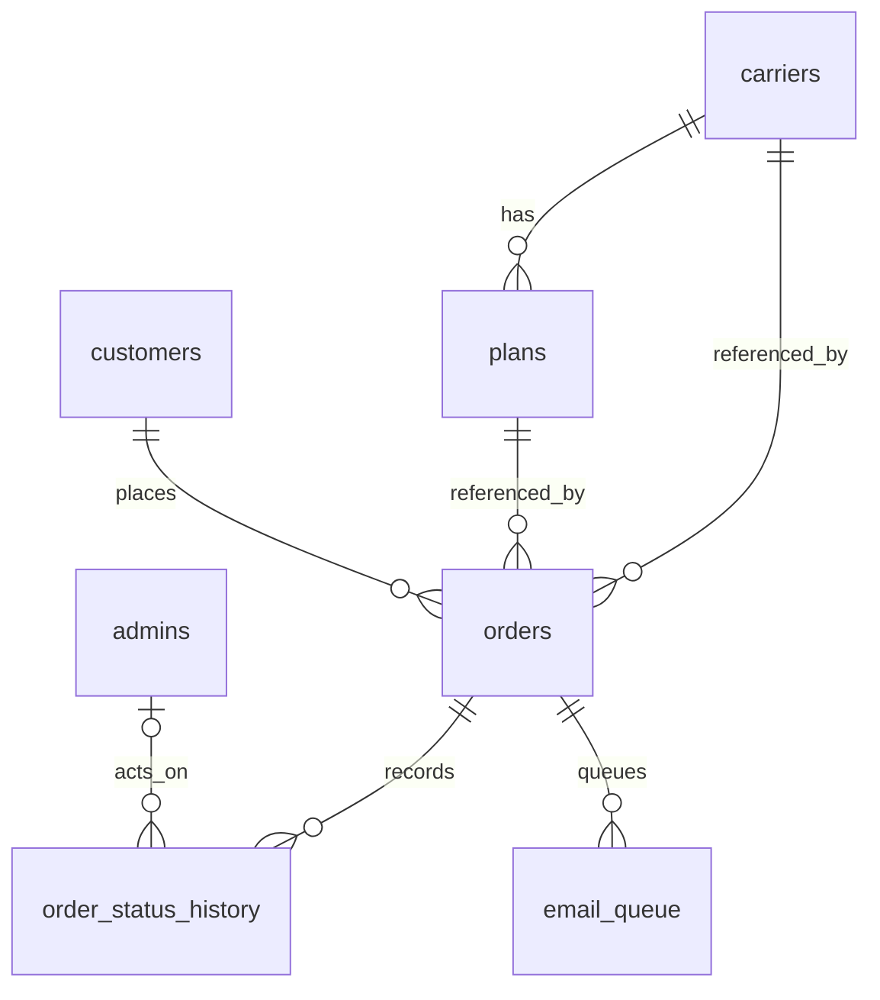

# MI Tech Wireless database reference

This is the schema at application baseline `b5f4258`, documented on **October 16, 2026**. It covers every table and column installed by the application. [Return to the developer guide](../DEVELOPER_GUIDE.md#database-and-record-lifecycle).

Install into an empty utf8mb4 MySQL-compatible database using the installer. It applies `schema.sql`, `demo.sql` and `selected-carriers.sql` in that order. The definitions below are references, not an upgrade script. Do not replay them over production tables.

Money uses integer USD cents. Date fields are interpreted as UTC by the application; ensure the database session/server timezone is UTC for CURRENT_TIMESTAMP defaults. Amounts, references and customer/product fields on orders are snapshots. The application stores no full card numbers or CVC.

## Relationships



`demo_submissions`, `settings`, `rate_limits` and `webhook_events` are independent tables without these foreign keys. Request records use product/contact snapshots; there is no request-to-order link.

## Table index

- [carriers](#carriers) — Carrier identity, public visibility, display ordering and source information.
- [plans](#plans) — Database-backed service/credit descriptions, prices, allowances and purchase verification.
- [customers](#customers) — Guest customer profile for the real Stripe checkout.
- [admins](#admins) — Administrator authentication and session invalidation.
- [orders](#orders) — Stripe order identity, purchased snapshots, payment/refund state and manual fulfillment.
- [order_status_history](#order_status_history) — Append-only history written by the application for covered order events.
- [settings](#settings) — String-valued store configuration and encrypted integration credentials.
- [rate_limits](#rate_limits) — Shared application attempt counters.
- [webhook_events](#webhook_events) — Stripe event deduplication.
- [email_queue](#email_queue) — Durable transactional mail jobs.
- [demo_submissions](#demo_submissions) — Current unpaid checkout contact/request storage; legacy table name retained.

## carriers

Carrier identity, public visibility, display ordering and source information.

Referenced by plans and orders. The current catalog migration expects selected slugs to exist and updates them in place. Disable used carriers instead of deleting them.

Schema source: [schema.sql](../sql/schema.sql).

| Column | Type and constraints | Meaning |
| --- | --- | --- |
| `id` | `BIGINT UNSIGNED AUTO_INCREMENT PRIMARY KEY` | Internal auto-increment row identifier. |
| `name` | `VARCHAR(100) NOT NULL` | Display name or customer/administrator identity as appropriate to this table. |
| `slug` | `VARCHAR(100) NOT NULL UNIQUE` | Unique public carrier URL segment and metadata lookup key. |
| `logo` | `VARCHAR(255) NOT NULL DEFAULT ''` | Public logo asset path. |
| `color` | `CHAR(7) NOT NULL DEFAULT '#222222'` | Hex color used for fallback carrier wordmark. |
| `description` | `TEXT NOT NULL` | Product or carrier text displayed to the customer. |
| `number_hint` | `VARCHAR(255) NOT NULL DEFAULT 'Enter your existing 10-digit US prepaid mobile number.'` | Carrier phone-entry help text. |
| `source_url` | `VARCHAR(500) NOT NULL DEFAULT ''` | Recorded carrier/product source URL. |
| `active` | `TINYINT NOT NULL DEFAULT 1` | Visibility flag; active carrier and plan are required at checkout. |
| `sort_order` | `INT NOT NULL DEFAULT 0` | Display ordering; lower numbers come first. |
| `created_at` | `DATETIME NOT NULL DEFAULT CURRENT_TIMESTAMP` | Record creation time; defaults to database CURRENT_TIMESTAMP. |

Exact table definition:

```sql
CREATE TABLE carriers (
 id BIGINT UNSIGNED AUTO_INCREMENT PRIMARY KEY,
 name VARCHAR(100) NOT NULL, slug VARCHAR(100) NOT NULL UNIQUE,
 logo VARCHAR(255) NOT NULL DEFAULT '', color CHAR(7) NOT NULL DEFAULT '#222222',
 description TEXT NOT NULL, number_hint VARCHAR(255) NOT NULL DEFAULT 'Enter your existing 10-digit US prepaid mobile number.',
 source_url VARCHAR(500) NOT NULL DEFAULT '', active TINYINT NOT NULL DEFAULT 1, sort_order INT NOT NULL DEFAULT 0,
 created_at DATETIME NOT NULL DEFAULT CURRENT_TIMESTAMP
) ENGINE=InnoDB;
```

## plans

Database-backed service/credit descriptions, prices, allowances and purchase verification.

Referenced by orders. There is no unique database constraint on carrier_id plus name; the catalog migration checks matching names before inserting. Category/eligibility/selectability live in JSON, not columns. The migration resets verify_pricing to 1.

Schema source: [schema.sql](../sql/schema.sql).

| Column | Type and constraints | Meaning |
| --- | --- | --- |
| `id` | `BIGINT UNSIGNED AUTO_INCREMENT PRIMARY KEY` | Internal auto-increment row identifier. |
| `carrier_id` | `BIGINT UNSIGNED NOT NULL` | Carrier relationship. |
| `name` | `VARCHAR(150) NOT NULL` | Display name or customer/administrator identity as appropriate to this table. |
| `price_cents` | `INT UNSIGNED NOT NULL` | Plan price in integer USD cents. |
| `data_allowance` | `VARCHAR(100) NOT NULL DEFAULT ''` | Display text for data benefits. |
| `talk` | `VARCHAR(100) NOT NULL DEFAULT ''` | Display text for calling benefits. |
| `texts` | `VARCHAR(100) NOT NULL DEFAULT ''` | Display text for messaging benefits. |
| `validity_days` | `SMALLINT UNSIGNED NOT NULL DEFAULT 30` | Numeric term; 0 means consult explicit metadata, not unlimited validity. |
| `description` | `TEXT NOT NULL` | Product or carrier text displayed to the customer. |
| `popular` | `TINYINT NOT NULL DEFAULT 0` | Featured-plan badge flag. |
| `active` | `TINYINT NOT NULL DEFAULT 1` | Visibility flag; active carrier and plan are required at checkout. |
| `verify_pricing` | `TINYINT NOT NULL DEFAULT 1` | 1 prevents real Stripe purchase; 0 means operator verified the product. |
| `sort_order` | `INT NOT NULL DEFAULT 0` | Display ordering; lower numbers come first. |

Additional constraints and indexes:

- `FOREIGN KEY (carrier_id) REFERENCES carriers(id) ON DELETE RESTRICT`

Exact table definition:

```sql
CREATE TABLE plans (
 id BIGINT UNSIGNED AUTO_INCREMENT PRIMARY KEY, carrier_id BIGINT UNSIGNED NOT NULL,
 name VARCHAR(150) NOT NULL, price_cents INT UNSIGNED NOT NULL, data_allowance VARCHAR(100) NOT NULL DEFAULT '',
 talk VARCHAR(100) NOT NULL DEFAULT '', texts VARCHAR(100) NOT NULL DEFAULT '', validity_days SMALLINT UNSIGNED NOT NULL DEFAULT 30,
 description TEXT NOT NULL, popular TINYINT NOT NULL DEFAULT 0, active TINYINT NOT NULL DEFAULT 1,
 verify_pricing TINYINT NOT NULL DEFAULT 1, sort_order INT NOT NULL DEFAULT 0,
 FOREIGN KEY (carrier_id) REFERENCES carriers(id) ON DELETE RESTRICT
) ENGINE=InnoDB;
```

## customers

Guest customer profile for the real Stripe checkout.

Email is unique. Existing profiles are reused without replacing their contact values; each order stores its own contact snapshot. Unpaid requests do not create these rows.

Schema source: [schema.sql](../sql/schema.sql).

| Column | Type and constraints | Meaning |
| --- | --- | --- |
| `id` | `BIGINT UNSIGNED AUTO_INCREMENT PRIMARY KEY` | Internal auto-increment row identifier. |
| `email` | `VARCHAR(254) NOT NULL UNIQUE` | Normalized email; unique only on customers/admins, not on orders/requests. |
| `name` | `VARCHAR(150) NOT NULL` | Display name or customer/administrator identity as appropriate to this table. |
| `phone` | `CHAR(10) NOT NULL` | Normalized ten-digit US contact number. |
| `zip` | `VARCHAR(10) NOT NULL` | US billing ZIP for Stripe records; empty for new request records. |
| `created_at` | `DATETIME NOT NULL DEFAULT CURRENT_TIMESTAMP` | Record creation time; defaults to database CURRENT_TIMESTAMP. |

Exact table definition:

```sql
CREATE TABLE customers (
 id BIGINT UNSIGNED AUTO_INCREMENT PRIMARY KEY, email VARCHAR(254) NOT NULL UNIQUE,
 name VARCHAR(150) NOT NULL, phone CHAR(10) NOT NULL, zip VARCHAR(10) NOT NULL,
 created_at DATETIME NOT NULL DEFAULT CURRENT_TIMESTAMP
) ENGINE=InnoDB;
```

## admins

Administrator authentication and session invalidation.

Passwords use PHP password_hash/password_verify. The installer creates one forced-change account. session_version increments on password change. No role or MFA fields exist.

Schema source: [schema.sql](../sql/schema.sql).

| Column | Type and constraints | Meaning |
| --- | --- | --- |
| `id` | `BIGINT UNSIGNED AUTO_INCREMENT PRIMARY KEY` | Internal auto-increment row identifier. |
| `email` | `VARCHAR(254) NOT NULL UNIQUE` | Normalized email; unique only on customers/admins, not on orders/requests. |
| `password_hash` | `VARCHAR(255) NOT NULL` | PHP password hash, never a plaintext password. |
| `must_change_password` | `TINYINT NOT NULL DEFAULT 1` | Forces initial password change when 1. |
| `session_version` | `INT NOT NULL DEFAULT 1` | Incremented to invalidate previously issued admin sessions. |
| `created_at` | `DATETIME NOT NULL DEFAULT CURRENT_TIMESTAMP` | Record creation time; defaults to database CURRENT_TIMESTAMP. |

Exact table definition:

```sql
CREATE TABLE admins (
 id BIGINT UNSIGNED AUTO_INCREMENT PRIMARY KEY, email VARCHAR(254) NOT NULL UNIQUE,
 password_hash VARCHAR(255) NOT NULL, must_change_password TINYINT NOT NULL DEFAULT 1,
 session_version INT NOT NULL DEFAULT 1, created_at DATETIME NOT NULL DEFAULT CURRENT_TIMESTAMP
) ENGINE=InnoDB;
```

## orders

Stripe order identity, purchased snapshots, payment/refund state and manual fulfillment.

The server snapshots product/customer details and amount at creation. Raw card number, expiry and CVC are absent; processor-returned card_brand and card_last4 are stored. payment_id can be NULL until creation at Stripe succeeds. Access is session-bound through access_hash. payment_status and recharge_status are independent strings, not database ENUMs.

Schema source: [schema.sql](../sql/schema.sql).

| Column | Type and constraints | Meaning |
| --- | --- | --- |
| `id` | `BIGINT UNSIGNED AUTO_INCREMENT PRIMARY KEY` | Internal auto-increment row identifier. |
| `order_number` | `VARCHAR(32) NOT NULL UNIQUE` | Random public MI- order reference, unique. |
| `customer_id` | `BIGINT UNSIGNED NOT NULL` | Related guest customer profile. |
| `carrier_id` | `BIGINT UNSIGNED NOT NULL` | Carrier relationship. |
| `plan_id` | `BIGINT UNSIGNED NOT NULL` | Related catalog plan; order snapshot is retained separately. |
| `customer_name` | `VARCHAR(150) NOT NULL` | Submitted name snapshot. |
| `email` | `VARCHAR(254) NOT NULL` | Normalized email; unique only on customers/admins, not on orders/requests. |
| `customer_phone` | `CHAR(10) NOT NULL` | Submitted contact phone; equals recharge_phone in request checkout. |
| `recharge_phone` | `CHAR(10) NOT NULL` | Ten-digit number intended for the refill. |
| `zip` | `VARCHAR(10) NOT NULL` | US billing ZIP for Stripe records; empty for new request records. |
| `carrier_name` | `VARCHAR(100) NOT NULL` | Carrier-name snapshot at checkout. |
| `plan_name` | `VARCHAR(150) NOT NULL` | Plan-name snapshot at checkout. |
| `plan_description` | `TEXT NOT NULL` | Plan-description snapshot at purchase. |
| `amount_cents` | `INT UNSIGNED NOT NULL` | Server-derived selected price or order amount in integer USD cents. |
| `currency` | `CHAR(3) NOT NULL DEFAULT 'usd'` | Payment currency; current implementation uses usd. |
| `payment_id` | `VARCHAR(255) NULL UNIQUE` | Stripe PaymentIntent identifier, unique when populated. |
| `payment_status` | `VARCHAR(24) NOT NULL DEFAULT 'pending'` | pending, paid, failed, partially_refunded or refunded. |
| `recharge_status` | `VARCHAR(24) NOT NULL DEFAULT 'awaiting_payment'` | awaiting_payment, processing, recharged, failed or refunded. |
| `stripe_mode` | `VARCHAR(8) NOT NULL DEFAULT 'test'` | Processor environment: test or live. |
| `card_brand` | `VARCHAR(30) NOT NULL DEFAULT ''` | Processor-returned card brand; no full card number. |
| `card_last4` | `VARCHAR(4) NOT NULL DEFAULT ''` | Processor-returned last four digits only. |
| `refunded_cents` | `INT UNSIGNED NOT NULL DEFAULT 0` | Confirmed refunded amount, from canonical Stripe charge data. |
| `refund_id` | `VARCHAR(255) NULL` | Refund identifier saved by the admin refund action. |
| `access_hash` | `CHAR(64) NOT NULL` | SHA-256 hash of the session-held access value for thank-you authorization. |
| `checkout_key` | `CHAR(64) NOT NULL UNIQUE` | Unique deduplication key; raw selection key for requests, derived details hash for orders. |
| `notes` | `TEXT NOT NULL` | Private fulfillment notes; not displayed by public order_details. |
| `created_at` | `DATETIME NOT NULL DEFAULT CURRENT_TIMESTAMP` | Record creation time; defaults to database CURRENT_TIMESTAMP. |
| `updated_at` | `DATETIME NOT NULL DEFAULT CURRENT_TIMESTAMP ON UPDATE CURRENT_TIMESTAMP` | Database-maintained last update time. |
| `paid_at` | `DATETIME NULL` | Set once on confirmed successful payment using UTC_TIMESTAMP. |

Additional constraints and indexes:

- `FOREIGN KEY (customer_id) REFERENCES customers(id)`
- `FOREIGN KEY (carrier_id) REFERENCES carriers(id)`
- `FOREIGN KEY (plan_id) REFERENCES plans(id)`
- `INDEX orders_created (created_at)`
- `INDEX orders_status (payment_status,recharge_status)`
- `INDEX orders_email(email)`

Exact table definition:

```sql
CREATE TABLE orders (
 id BIGINT UNSIGNED AUTO_INCREMENT PRIMARY KEY, order_number VARCHAR(32) NOT NULL UNIQUE,
 customer_id BIGINT UNSIGNED NOT NULL, carrier_id BIGINT UNSIGNED NOT NULL, plan_id BIGINT UNSIGNED NOT NULL,
 customer_name VARCHAR(150) NOT NULL, email VARCHAR(254) NOT NULL, customer_phone CHAR(10) NOT NULL,
 recharge_phone CHAR(10) NOT NULL, zip VARCHAR(10) NOT NULL,
 carrier_name VARCHAR(100) NOT NULL, plan_name VARCHAR(150) NOT NULL, plan_description TEXT NOT NULL,
 amount_cents INT UNSIGNED NOT NULL, currency CHAR(3) NOT NULL DEFAULT 'usd',
 payment_id VARCHAR(255) NULL UNIQUE, payment_status VARCHAR(24) NOT NULL DEFAULT 'pending',
 recharge_status VARCHAR(24) NOT NULL DEFAULT 'awaiting_payment', stripe_mode VARCHAR(8) NOT NULL DEFAULT 'test',
 card_brand VARCHAR(30) NOT NULL DEFAULT '', card_last4 VARCHAR(4) NOT NULL DEFAULT '',
 refunded_cents INT UNSIGNED NOT NULL DEFAULT 0, refund_id VARCHAR(255) NULL,
 access_hash CHAR(64) NOT NULL, checkout_key CHAR(64) NOT NULL UNIQUE,
 notes TEXT NOT NULL, created_at DATETIME NOT NULL DEFAULT CURRENT_TIMESTAMP,
 updated_at DATETIME NOT NULL DEFAULT CURRENT_TIMESTAMP ON UPDATE CURRENT_TIMESTAMP,
 paid_at DATETIME NULL, FOREIGN KEY (customer_id) REFERENCES customers(id),
 FOREIGN KEY (carrier_id) REFERENCES carriers(id), FOREIGN KEY (plan_id) REFERENCES plans(id),
 INDEX orders_created (created_at), INDEX orders_status (payment_status,recharge_status), INDEX orders_email(email)
) ENGINE=InnoDB;
```

## order_status_history

Append-only history written by the application for covered order events.

admin_id is NULL for system events. Messages record status changes and the existence of internal-note updates, not the full note content. This is not a universal audit log for catalog or settings edits.

Schema source: [schema.sql](../sql/schema.sql).

| Column | Type and constraints | Meaning |
| --- | --- | --- |
| `id` | `BIGINT UNSIGNED AUTO_INCREMENT PRIMARY KEY` | Internal auto-increment row identifier. |
| `order_id` | `BIGINT UNSIGNED NOT NULL` | Related real order. |
| `status` | `VARCHAR(40) NOT NULL` | History event label, or pending/sent for an email job. |
| `message` | `TEXT NOT NULL` | Human-readable order event message. |
| `admin_id` | `BIGINT UNSIGNED NULL` | Acting administrator; NULL for system events. |
| `created_at` | `DATETIME NOT NULL DEFAULT CURRENT_TIMESTAMP` | Record creation time; defaults to database CURRENT_TIMESTAMP. |

Additional constraints and indexes:

- `FOREIGN KEY (order_id) REFERENCES orders(id)`
- `FOREIGN KEY (admin_id) REFERENCES admins(id)`

Exact table definition:

```sql
CREATE TABLE order_status_history (
 id BIGINT UNSIGNED AUTO_INCREMENT PRIMARY KEY, order_id BIGINT UNSIGNED NOT NULL,
 status VARCHAR(40) NOT NULL, message TEXT NOT NULL, admin_id BIGINT UNSIGNED NULL,
 created_at DATETIME NOT NULL DEFAULT CURRENT_TIMESTAMP,
 FOREIGN KEY (order_id) REFERENCES orders(id), FOREIGN KEY (admin_id) REFERENCES admins(id)
) ENGINE=InnoDB;
```

## settings

String-valued store configuration and encrypted integration credentials.

Primary key is the setting name. Secret API/webhook/SMTP values use AES-256-GCM via seal(); public keys and presentation settings are plain strings. JSON settings include faqs and footer_links. See the guide for all supported keys.

Schema source: [schema.sql](../sql/schema.sql).

| Column | Type and constraints | Meaning |
| --- | --- | --- |
| `key` | `VARCHAR(100) PRIMARY KEY` | Setting name. |
| `value` | `MEDIUMTEXT NOT NULL` | Setting value; string, JSON or sealed secret depending on key. |

Exact table definition:

```sql
CREATE TABLE settings (`key` VARCHAR(100) PRIMARY KEY, `value` MEDIUMTEXT NOT NULL) ENGINE=InnoDB;
```

## rate_limits

Shared application attempt counters.

bucket is an HMAC of scope and identity using app_key; raw IP/email is not stored in this table. expires_at is Unix epoch seconds. Cron removes rows expired more than a day ago. Counts can include successful attempts.

Schema source: [schema.sql](../sql/schema.sql).

| Column | Type and constraints | Meaning |
| --- | --- | --- |
| `bucket` | `CHAR(64) PRIMARY KEY` | HMAC-derived scope/identity rate-limit key. |
| `attempts` | `INT UNSIGNED NOT NULL DEFAULT 0` | Rate-limit count or email send-attempt count. |
| `expires_at` | `BIGINT NOT NULL` | Rate-limit window expiry as Unix epoch seconds. |

Exact table definition:

```sql
CREATE TABLE rate_limits (
 bucket CHAR(64) PRIMARY KEY, attempts INT UNSIGNED NOT NULL DEFAULT 0, expires_at BIGINT NOT NULL
) ENGINE=InnoDB;
```

## webhook_events

Stripe event deduplication.

Stores the provider event ID after successful handling or acknowledgement, not the webhook payload. Duplicate IDs return success. No foreign key to orders is stored here.

Schema source: [schema.sql](../sql/schema.sql).

| Column | Type and constraints | Meaning |
| --- | --- | --- |
| `event_id` | `VARCHAR(255) PRIMARY KEY` | Unique Stripe event identifier. |
| `processed_at` | `DATETIME NOT NULL DEFAULT CURRENT_TIMESTAMP` | Database timestamp when the event was recorded. |

Exact table definition:

```sql
CREATE TABLE webhook_events (event_id VARCHAR(255) PRIMARY KEY, processed_at DATETIME NOT NULL DEFAULT CURRENT_TIMESTAMP) ENGINE=InnoDB;
```

## email_queue

Durable transactional mail jobs.

Unique (order_id,kind) prevents duplicate enqueueing. kind is receipt, admin_alert or completed. status is pending or sent in the current implementation; exhausted failures remain pending with attempts >= 8. A MySQL advisory lock serializes workers.

Schema source: [schema.sql](../sql/schema.sql).

| Column | Type and constraints | Meaning |
| --- | --- | --- |
| `id` | `BIGINT UNSIGNED AUTO_INCREMENT PRIMARY KEY` | Internal auto-increment row identifier. |
| `order_id` | `BIGINT UNSIGNED NOT NULL` | Related real order. |
| `kind` | `VARCHAR(40) NOT NULL` | Email purpose: receipt, admin_alert or completed. |
| `recipient` | `VARCHAR(254) NOT NULL` | Email recipient captured when queued. |
| `status` | `VARCHAR(20) NOT NULL DEFAULT 'pending'` | History event label, or pending/sent for an email job. |
| `attempts` | `INT NOT NULL DEFAULT 0` | Rate-limit count or email send-attempt count. |
| `last_error` | `VARCHAR(255) NOT NULL DEFAULT ''` | Generic SMTP failure description; no credentials. |
| `available_at` | `DATETIME NOT NULL DEFAULT CURRENT_TIMESTAMP` | Earliest time for the next delivery attempt. |
| `sent_at` | `DATETIME NULL` | Time saved after SMTP acceptance. |

Additional constraints and indexes:

- `UNIQUE KEY email_once(order_id,kind)`
- `FOREIGN KEY(order_id) REFERENCES orders(id)`

Exact table definition:

```sql
CREATE TABLE email_queue (
 id BIGINT UNSIGNED AUTO_INCREMENT PRIMARY KEY, order_id BIGINT UNSIGNED NOT NULL,
 kind VARCHAR(40) NOT NULL, recipient VARCHAR(254) NOT NULL, status VARCHAR(20) NOT NULL DEFAULT 'pending',
 attempts INT NOT NULL DEFAULT 0, last_error VARCHAR(255) NOT NULL DEFAULT '',
 available_at DATETIME NOT NULL DEFAULT CURRENT_TIMESTAMP, sent_at DATETIME NULL,
 UNIQUE KEY email_once(order_id,kind), FOREIGN KEY(order_id) REFERENCES orders(id)
) ENGINE=InnoDB;
```

## demo_submissions

Current unpaid checkout contact/request storage; legacy table name retained.

No foreign keys, payment fields or card fields exist. The two phone columns hold the same submitted number and new zip values are empty. completed_at NULL means details saved; non-NULL means submitted. completion does not create an order, collect payment or enqueue mail.

Schema source: [demo.sql](../sql/demo.sql).

| Column | Type and constraints | Meaning |
| --- | --- | --- |
| `id` | `BIGINT UNSIGNED AUTO_INCREMENT PRIMARY KEY` | Internal auto-increment row identifier. |
| `reference` | `VARCHAR(32) NOT NULL UNIQUE` | Unique MI-RQ- request reference; older DEMO- references are retained. |
| `checkout_key` | `CHAR(64) NOT NULL UNIQUE` | Unique deduplication key; raw selection key for requests, derived details hash for orders. |
| `access_hash` | `CHAR(64) NOT NULL` | SHA-256 hash of the session-held access value for thank-you authorization. |
| `carrier_name` | `VARCHAR(100) NOT NULL` | Carrier-name snapshot at checkout. |
| `plan_name` | `VARCHAR(150) NOT NULL` | Plan-name snapshot at checkout. |
| `amount_cents` | `INT UNSIGNED NOT NULL` | Server-derived selected price or order amount in integer USD cents. |
| `customer_name` | `VARCHAR(150) NOT NULL` | Submitted name snapshot. |
| `email` | `VARCHAR(254) NOT NULL` | Normalized email; unique only on customers/admins, not on orders/requests. |
| `customer_phone` | `CHAR(10) NOT NULL` | Submitted contact phone; equals recharge_phone in request checkout. |
| `recharge_phone` | `CHAR(10) NOT NULL` | Ten-digit number intended for the refill. |
| `zip` | `VARCHAR(10) NOT NULL` | US billing ZIP for Stripe records; empty for new request records. |
| `created_at` | `DATETIME NOT NULL DEFAULT CURRENT_TIMESTAMP` | Record creation time; defaults to database CURRENT_TIMESTAMP. |
| `completed_at` | `DATETIME NULL` | First successful request-completion timestamp; NULL while only contact details are saved. |

Additional constraints and indexes:

- `INDEX demo_email(email)`
- `INDEX demo_created(created_at)`

Exact table definition:

```sql
CREATE TABLE IF NOT EXISTS demo_submissions (
 id BIGINT UNSIGNED AUTO_INCREMENT PRIMARY KEY,
 reference VARCHAR(32) NOT NULL UNIQUE,
 checkout_key CHAR(64) NOT NULL UNIQUE, access_hash CHAR(64) NOT NULL,
 carrier_name VARCHAR(100) NOT NULL, plan_name VARCHAR(150) NOT NULL,
 amount_cents INT UNSIGNED NOT NULL,
 customer_name VARCHAR(150) NOT NULL, email VARCHAR(254) NOT NULL,
 customer_phone CHAR(10) NOT NULL, recharge_phone CHAR(10) NOT NULL, zip VARCHAR(10) NOT NULL,
 created_at DATETIME NOT NULL DEFAULT CURRENT_TIMESTAMP, completed_at DATETIME NULL,
 INDEX demo_email(email), INDEX demo_created(created_at)
) ENGINE=InnoDB DEFAULT CHARSET=utf8mb4;
```

## Data preservation rules

- Never use installation or seed replay as an upgrade. Back up before additive migrations and reviewed catalog updates.
- Preserve historical order/customer/request snapshots. Disable referenced catalog rows rather than deleting them.
- The catalog migration uses slug/name matching and resets verification. It does not delete orders, customers or contacts.
- No automatic data-retention worker exists. Contact deletion/export and backup retention need an authorized operational procedure.
- Store the application key with protected backups; encrypted settings cannot be recovered from the database alone.
- Do not include a database dump or real customer rows in this public repository.

This reference covers **11 tables and 101 columns**. Update it alongside reviewed schema changes.
